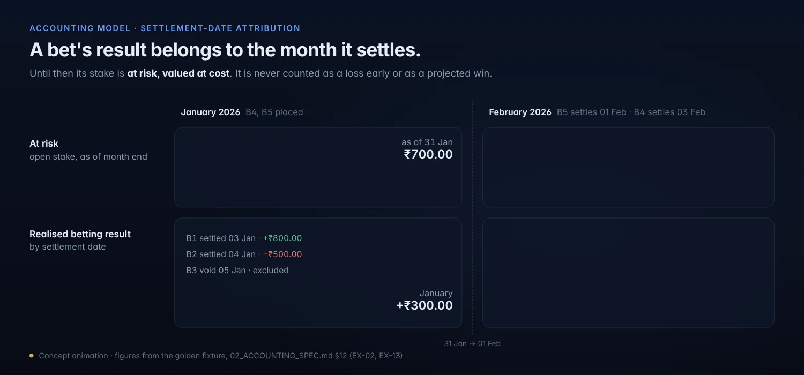
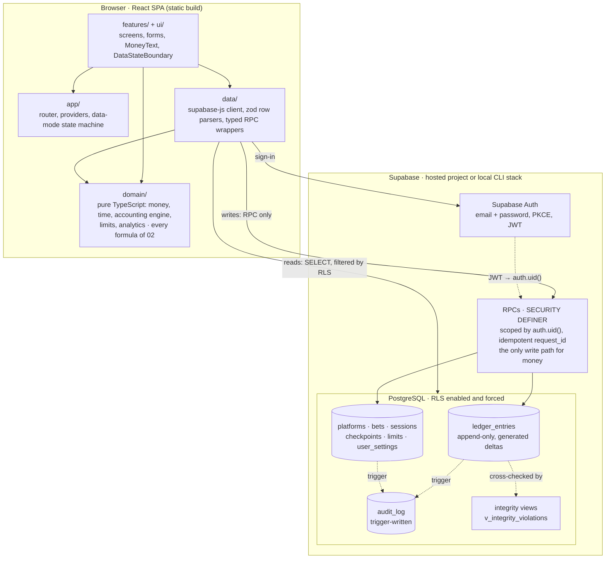

<p align="center">
  <picture>
    <source media="(prefers-reduced-motion: reduce)" srcset="assets/readme/hero-3d.png">
    
  </picture>
</p>

<h1 align="center">Tarazu</h1>

<p align="center">
  <strong>Know your true numbers.</strong><br>
  <sub>For Gamblers, By a Gambler.</sub>
</p>

<p align="center">
  A private, exact ledger for your gambling activity.<br>
  Know where your money went. Know what it cost.
</p>

<p align="center">
  <code>status: M0 · foundations in progress</code>&nbsp;
  <code>specs: draft v0.1</code>&nbsp;
  <code>INR · integer paise</code>&nbsp;
  <code>license: not yet selected</code>
</p>

<p align="center">
  <a href="#overview">Overview</a> ·
  <a href="#principles">Principles</a> ·
  <a href="#accounting-model">Accounting</a> ·
  <a href="#architecture">Architecture</a> ·
  <a href="#security-and-privacy">Security</a> ·
  <a href="#roadmap">Roadmap</a> ·
  <a href="#development-setup">Setup</a>
</p>

> [!IMPORTANT]
> **Tarazu is not usable yet.** This repository holds a full specification set and an M0 tooling scaffold. There is no accounting engine, no database schema and no user interface yet. Every screen in this README is a **concept mockup**, and every rupee figure comes from the worked example in [`02_ACCOUNTING_SPEC.md` §12](02_ACCOUNTING_SPEC.md#12-worked-example-golden-fixture). None of it is real account data.

---

## Contents

- [Overview](#overview)
- [Principles](#principles)
- [What Tarazu will and will not do](#what-tarazu-will-and-will-not-do)
- [Dashboard concept](#dashboard-concept)
- [Accounting model](#accounting-model)
- [Architecture](#architecture)
- [Technology stack](#technology-stack)
- [Repository structure](#repository-structure)
- [Development setup](#development-setup)
- [Testing and accounting correctness](#testing-and-accounting-correctness)
- [Security and privacy](#security-and-privacy)
- [Roadmap](#roadmap)
- [Project status and limitations](#project-status-and-limitations)
- [Contributing](#contributing)
- [License](#license)
- [Documentation map](#documentation-map)

---

## Overview

**Tarazu** (तराज़ू, *weighing scale*) is a personal web app for **recordkeeping and financial accountability** about gambling. You enter what happened by hand: bets, deposits, withdrawals, payouts, fees, refunds, bonuses and the balances platforms show. Tarazu turns those records into exact, auditable numbers.

It answers four questions ([`01_PRD.md` §2](01_PRD.md#2-problem-and-goals)):

1. How much money is where, and how much is in play right now?
2. How much have I put in and taken out (cash flow), separately from what betting itself returned?
3. What did betting actually cost or return, after every fee and bonus?
4. Am I within the limits I set myself, and are my recorded patterns changing?

### The problem

Platform screens blur together things that are not the same:

- a **withdrawal** is money coming home, not profit;
- a **deposit** is money going out, not a loss;
- a **payout** includes your own stake coming back;
- a **bonus** is a credit, not a betting win;
- an **open bet** is money at risk, not money lost yet.

Add all of these into one "profit" number and the number misleads. Tarazu keeps them in **separate families** and combines them only in one named, itemised figure: the [All-in net result](#all-in-net-result).

### Who it is for

One adult in India who bets on one to ten platforms and wants a precise, private record of what it costs. They might be tracking out of curiosity, for discipline, or because they are trying to cut down. They may open the app after a bad session, so it has to be calm, factual and impossible to misread. They use a phone and a laptop, type everything in by hand, and will not accept rounding or hidden estimates.

Tarazu is a **financial accountability tool**. It is not a betting platform, a casino, a community or a strategy product. It does not help anyone gamble better. It shows what recorded activity means in money.

---

## Principles

These come from [`00_MASTER_SPEC.md` §5](00_MASTER_SPEC.md#5-principles) and are binding on every change.

| ID | Principle | What it means in practice |
|---|---|---|
| P-1 | **Honest numbers** | No fabricated, estimated or placeholder figures. No seed data in production. Demo mode exists only in non-production builds, behind a permanent banner. |
| P-2 | **Exact arithmetic** | Money is integer **paise** as `bigint` from the form to PostgreSQL. No floats on any money path. Ratios use integer basis points. |
| P-3 | **Unknown is not zero** | Loading, error and offline states show `—` with an explanation, never `₹0`. |
| P-4 | **One source of money truth** | Only ledger entries move balances. Bets carry no money columns. |
| P-5 | **Append-only history** | Mistakes are fixed by adding a reversal. Nothing is overwritten or deleted. |
| P-6 | **Cash flow is not performance** | Deposits and withdrawals, betting results and position are separate metric families. |
| P-7 | **No double counting** | One real-world event becomes exactly one ledger event. Payouts exist only by settling a bet. |
| P-8 | **Isolation by construction** | Every row is per user. RLS is forced. Clients never supply `user_id`. |
| P-9 | **Tests before features** | Acceptance criteria and failing tests exist before the code they gate. |
| P-10 | **Accountability, not encouragement** | Neutral tone, friction on risky changes, no engagement mechanics. |
| P-11 | **Honest connectivity** | Nothing is shown as saved until the backend confirms it. No optimistic ledger writes. No "sync" wording. |

---

## What Tarazu will and will not do

Status key: **Specified** means it is designed and has acceptance criteria. Nothing below is implemented yet.

### MVP (milestones M0–M7, priority P0)

| Area | Specified behaviour | Spec |
|---|---|---|
| Platforms and balances | Per-platform balance, at-risk stake and equity; opening balances; archive and unarchive | FR-002 |
| Transaction ledger | Deposits, withdrawals, transfers, fees, fee refunds and bonuses; keyset-paginated history; corrections by reversal only; duplicate warnings | FR-003 |
| Bets and settlement | Place, settle, void, resettle, reopen, correct and annul; total-return settlement; commissions | FR-004 |
| Sessions | Start and end; summaries; at most one open session; a neutral prompt after 12 h | FR-005 |
| Reconciliation | Checkpoints against the balance a platform shows; matched, open and resolved states; adjustments that require a note | FR-006 |
| Dashboard | Position, money in and out, betting performance, and an itemised All-in net result | FR-007 |
| JSON export | One consistent snapshot of every user table, with paise as decimal strings | FR-010 |
| Settings | Time zone, week start and privacy mode | FR-011 |
| Integrity | Honest data-mode states; a Diagnostics screen for integrity findings | FR-012 |
| History | Audit trail for every platform, bet, entry, session and limit | FR-013 |
| Account | Email and password sign-in; account deletion with full purge | FR-001 |

### After MVP (milestones M8–M10, priority P1)

| Area | Specified behaviour | Spec |
|---|---|---|
| Limits | Advisory limits by metric and period. Tightening applies at once; loosening waits 24 h. Limits never block recording. | FR-009 |
| Risk signals | Factual indicators such as stake escalation or a rapid redeposit after a loss. They state facts and never advise. | `02` §6.6 |
| Analytics | Charts with table alternatives. No forecasts and no projections. | FR-008 |
| CSV export | Paise and rupee columns, protected against formula injection | FR-010 |
| Idle sign-out | Optional inactivity timeout | FR-011 |

### Never (anti-features, [`00` §1.2](00_MASTER_SPEC.md#12-non-goals-and-anti-features-hard-rules))

Tarazu will **never** offer betting advice, tips, predictions, odds comparison, expected-value or stake-sizing tools, loss-recovery targets, projected or potential winnings, bonus discovery, affiliate links, leaderboards, streaks or achievements, or notifications that prompt anyone to bet. Any proposal that touches this list is rejected without further analysis.

These are also **out of scope for v1**: connecting to platforms or banks (no scraping, APIs or statement import), multiple currencies, native mobile apps, offline writes, tax calculation, social features and AI features.

---

## Dashboard concept

<p align="center">
  <picture>
    <source media="(prefers-reduced-motion: reduce)" srcset="assets/readme/dashboard.png">
    
  </picture>
</p>
<p align="center"><sub>Concept mockup with a privacy-mode demo. Not a screenshot. Figures are the January rows of the golden fixture (EX-01 to EX-10).</sub></p>

The overview ([`05_UI_UX_SPEC.md` §5.2](05_UI_UX_SPEC.md#52-overview-dashboard--fr-007)) uses **three visually separate groups**. No figure is added across groups.

| Group | Answers | Key figures |
|---|---|---|
| **Position** (now) | Where is the money? | Total balance · At risk (open stake, at cost) · Equity · per platform |
| **Money in and out** (period) | What crossed my bank boundary? | Deposited · Withdrawn · Net deposited · Net cash (bank-side) · Friction fees |
| **Betting performance** (period) | What did betting return? | Realised betting result · Commissions · Net betting result · Turnover · Counts |

### All-in net result

Below the groups sits one combined figure, **always itemised**:

```
All-in net result = G − Cb − Cp + Bn + A − friction fees
```

It answers *"what did taking part actually cost or return, after every fee, bonus and reconciliation difference, ignoring how much was moved in or out?"* The dashboard has **no "profit" headline** and no single traffic light for the account.

Why not one number? In the January example, net cash is **+₹975**: ₹1,000 more was withdrawn than deposited, minus ₹25 of bank-side fees. Read alone, that looks like a ₹975 gain. Most of it is the ₹5,000 opening balance being drawn down. What taking part actually returned that month is the all-in result, **+₹405**. Both figures are correct. Only keeping them separate stops either from being misread.

---

## Accounting model

Authority: [`02_ACCOUNTING_SPEC.md`](02_ACCOUNTING_SPEC.md). This section is a summary. If it disagrees with `02`, `02` wins and this README has a bug.

### Money representation

- Integer **paise** (₹1 = 100 paise) as `bigint` in TypeScript and PostgreSQL. `1 ≤ amount ≤ 10¹²` paise per entry.
- User input is parsed **as a string**: at most two decimals, no exponent, no `parseFloat`. `"1,234.5"` becomes `123450`. Three decimals is a validation error, not a rounding.
- Ratios (yield, hit rate, utilisation) exist only for display, in basis points, rounded half away from zero. A zero denominator gives `null`, shown as `—`.
- Charts may convert to `Number` rupees at the final rendering step. That is the only place a float is allowed.

### The ledger

Every money movement is one immutable **ledger entry** on one platform, with a positive `amount`. A generated `platform_delta` and `bank_delta` follow from its type:

| Family | Entry types | Moves platform balance | Moves bank |
|---|---|:---:|:---:|
| Opening | `OPENING_BALANCE` | ✓ | — |
| External flow | `DEPOSIT`, `WITHDRAWAL` (optional off-platform `fee`) | ✓ | ✓ |
| Transfer | `TRANSFER_OUT`, `TRANSFER_IN` (paired, net zero) | ✓ | — |
| Betting | `BET_STAKE`, `BET_PAYOUT`, `BET_REFUND` | ✓ | — |
| Cost | `FEE`, `FEE_REFUND` (`BET_COMMISSION` or `PLATFORM_FEE`) | ✓ | — |
| Bonus | `BONUS_CREDIT`, `BONUS_FORFEIT` | ✓ | — |
| Adjustment | `ADJUSTMENT_CREDIT`, `ADJUSTMENT_DEBIT` (linked to a checkpoint) | ✓ | — |

There is deliberately **no "payout", "winnings" or "profit" entry type**. A payout exists only as a `BET_PAYOUT` created by settling a bet.

A fee is recorded **once, where it was charged**. If the platform deducted it from your balance, it is a `FEE` entry. If your bank, UPI or gateway charged it outside the platform, it is the `fee` field on the deposit or withdrawal.

### Bet lifecycle

```
place ─▶ OPEN ─┬─ settle(payout ≥ 0) ─▶ SETTLED ─┐
               └─ void ───────────────▶ VOID ────┤  resettle / reopen (corrections)
                                                 ▼
               any state ─ annul ─▶ ANNULLED (terminal; every linked entry reversed)
```

- A bet holds **no money fields**. Stake, payout and refund are derived from linked ledger entries.
- **Payout is total return**, stake included. A lost bet has payout 0 and no payout entry. The settle form can accept profit or loss, but it always shows the total return before you confirm.
- **Void** returns the stake in full. It is not a win, not a loss, and not part of turnover.

### Settlement-date attribution

Realised betting results belong to the period of the bet's **`settled_at`**. A bet placed on 30 Jan and settled on 1 Feb is February's result. Until then its stake is **at risk**, valued at cost and never at potential return:

```
equity = platform balance + open stake
```

<p align="center">
  <picture>
    <source media="(prefers-reduced-motion: reduce)" srcset="assets/readme/attribution.png">
    
  </picture>
</p>
<p align="center"><sub>Concept animation. Figures are EX-02 and EX-13 from the golden fixture.</sub></p>

Deposits, withdrawals, fees, bonuses and adjustments are attributed by the entry's own `occurred_at`. Bets placed are counted by `placed_at`.

### Reversals and corrections

The only way to change the ledger is a **reversal**: a mirror of the original entry with `sgn = −1`, so it cancels the original in every sum. An entry can be reversed once. A reversal cannot be reversed. "Correct" means reversal plus replacement, in one transaction. A reversal **inherits the original's date**, so corrected history reads as if it had always been right. `recorded_at` and the audit log show when the correction happened. Only `note` can be edited in place.

### Reconciliation checkpoints

A checkpoint records *"the platform showed ₹X at time T"* next to the ledger balance the server computes for T. Its state is `MATCHED` (no difference), `OPEN` (unexplained difference) or `RESOLVED`. The resolution flow sends you first to look for a missing or wrong entry. Only if the cause cannot be found does it offer an **adjustment**, which requires a note and appears as its own line in the All-in result. An adjustment can never hide inside betting performance.

### Invariants

All 15 invariants (`INV-ACC-01…15`) are required to have automated tests. These are the load-bearing ones:

| ID | Invariant |
|---|---|
| INV-ACC-04 | Every metric is unchanged by any reordering of the entries. |
| INV-ACC-05 | **Equity identity:** `Δequity = O + (D − W) + T + G − Cb − Cp + Bn + A` for any filter and window. |
| INV-ACC-06 | **All-in identity:** `allIn = netCash + Δequity − O − T`. |
| INV-ACC-07 | Every transfer group has one OUT and one IN of equal amount, netting to zero. |
| INV-ACC-10 | Payouts and refunds exist only through bet lifecycle actions; a real-world charge is recorded once. |
| INV-ACC-12 | Open bets are valued at cost; no metric uses odds or potential return. |

### Worked example

From the golden fixture (`02` §12): two platforms, **Alpha** and **Beta**, January 2026.

| Component | Symbol | January |
|---|:---:|---:|
| Realised betting result (B1 +800, B2 −500; B3 void) | G | +₹300.00 |
| Bet commissions | Cb | −₹50.00 |
| Platform fees | Cp | −₹100.00 |
| Bonuses | Bn | +₹300.00 |
| Reconciliation adjustment (checkpoint C1) | A | −₹20.00 |
| Friction fees (₹10 deposit + ₹15 withdrawal) | Fd + Fw | −₹25.00 |
| **All-in net result** | | **+₹405.00** |

Cross-check with the all-in identity, INV-ACC-06: net cash +₹975.00, plus Δequity (₹4,430.00 − ₹0), minus the opening balance ₹5,000.00, minus net transfers ₹0, equals **₹405.00** ✓.

In February, the January open stakes on B4 (₹400) and B5 (₹300) settle. They leave the at-risk column and become February's realised result of +₹200 (EX-13). That is settlement-date attribution in action.

---

## Architecture

Authority: [`04_TECHNICAL_ARCHITECTURE.md`](04_TECHNICAL_ARCHITECTURE.md) and [`03_DATABASE_SCHEMA.md`](03_DATABASE_SCHEMA.md). **All of this is planned.** Only the `app/` placeholder exists today.



| Layer | Responsibility | Boundary rule (lint-enforced) |
|---|---|---|
| `domain/` | Every formula in `02`, implemented **once** as pure functions: `positionAt`, `metricsFor`, `betResults`, `limitStatus`, `riskSignals`, `diagnostics` | No React, no Supabase, no I/O, never reads the clock ("now" is a parameter). No floats on money. |
| `data/` | Supabase client, zod validation of every row, RPC wrappers that create one `request_id` per user action and reuse it on retry | The only module that imports `@supabase/supabase-js` |
| `features/`, `ui/` | Screens and components. `DataStateBoundary` guarantees unknown values render as `—`. | `ui/` imports only `domain/money` |
| `app/` | Routing, providers and the **data-mode** machine (`CONFIG_MISSING`, `SIGNED_OUT`, `CHECKING`, `SCHEMA_MISMATCH`, `READY`, `DEGRADED`, `OFFLINE`, `DEMO`) | Financial figures render only in `READY` |
| Supabase Auth | Identity and short-lived JWTs | The browser holds only the public anon key and the user JWT |
| RPCs | Atomic multi-row writes: ledger, status and audit in one transaction | Derive the user from `auth.uid()`. Never accept `user_id`. `search_path = ''`. |
| PostgreSQL | Storage and enforcement: CHECKs, immutability triggers, composite FKs, deferred transfer balancing | Clients can only `SELECT` money tables; every write goes through an RPC |

**Why compute in the browser?** One user's ledger is small (planned for at most 50,000 entries). One pure TypeScript engine can be fully unit- and property-tested, and the dashboard, analytics and export all read the same snapshot. SQL views do not hold a second set of formulas. They are integrity cross-checks, and a **parity test** asserts that both sides agree (DEC-008).

---

## Technology stack

Selected in [DEC-015](DECISIONS.md#decided). The column "In `package.json`" reflects the repository today.

| Concern | Choice | Why | In `package.json` |
|---|---|---|:---:|
| Language | TypeScript (`strict`, `noUncheckedIndexedAccess`, `exactOptionalPropertyTypes`) | Native `bigint` for paise; strict null handling for unknown-vs-zero | ✓ |
| UI | React | Function components | ✓ |
| Build | Vite | Static single-page app output | ✓ |
| Styling | Tailwind CSS | Design tokens shared by light and dark themes | ✓ |
| Time zones | Luxon, confined to `domain/time` | DST-safe IANA bucketing for `[from, to)` windows | ✓ |
| Unit, property and component tests | Vitest, fast-check, Testing Library | Invariants checked over random valid ledgers | ✓ |
| End-to-end tests | Playwright | Critical user journeys against the local stack | ✓ |
| Accessibility tests | axe-core, run in Playwright | WCAG 2.2 AA gate | planned |
| Lint and format | ESLint (typescript-eslint, react-hooks, jsx-a11y), Prettier | Layering, float-ban and anti-feature rules | ✓ |
| Local backend | Supabase CLI | Local Auth and PostgreSQL stack | ✓ |
| Backend client | `@supabase/supabase-js` | Auth and PostgREST access | planned (M3) |
| Routing | React Router | Route-level code splitting | planned (M3) |
| Server state | TanStack Query | In memory only; never persisted (SEC-12) | planned (M3) |
| Forms and validation | react-hook-form + zod | zod also parses every row and RPC result at the boundary | planned (M3–M4) |
| Charts | Recharts | Loaded lazily on the analytics route | planned (M9) |
| Database tests | pgTAP on the local stack | Proves RLS, constraints, immutability and RPC behaviour | planned (M2) |
| CI | GitHub Actions | Six gates on every PR | workflow written, not yet run |

---

## Repository structure

Items marked *(planned)* do not exist yet.

```
Tarazu/
├─ 00_MASTER_SPEC.md … 08_IMPLEMENTATION_ROADMAP.md, DECISIONS.md   # authoritative specs
├─ README.md
├─ assets/readme/                 # README visuals (concept mockups)
├─ src/
│  ├─ main.tsx
│  ├─ app/                        # App.tsx placeholder + test; router, data-mode machine (planned)
│  ├─ domain/
│  │  ├─ money/                   # empty: Paise, parse/format, bps (planned, M1)
│  │  ├─ time/                    # empty: windows, tz bucketing (planned, M1)
│  │  ├─ accounting/              # empty: engine, position, metrics, diagnostics (planned, M1)
│  │  ├─ limits/                  # (planned, M8)
│  │  └─ analytics/               # (planned, M9)
│  ├─ data/                       # empty: Supabase client, zod schemas, RPC wrappers (planned, M3)
│  ├─ features/                   # empty: screens and hooks (planned, M3+)
│  └─ ui/                         # empty: MoneyText, MoneyInput, DataStateBoundary (planned, M3)
├─ supabase/
│  ├─ config.toml                 # from `supabase init`
│  ├─ migrations/                 # (planned, M2)
│  ├─ tests/                      # pgTAP (planned, M2)
│  └─ seed.sql                    # local dev only (planned, M2)
├─ tests/
│  ├─ setup.ts
│  ├─ lint/rules.test.ts          # float-ban and layering rule tests
│  ├─ static/vocabulary.test.ts   # forbidden-vocabulary scan of src/
│  ├─ e2e/smoke.spec.ts           # placeholder journey
│  └─ fixtures/accounting/        # empty: example-01.json golden fixture (planned, M1)
├─ scripts/
│  ├─ check-ac-traceability.mjs   # spec-ID ↔ test traceability gate
│  ├─ check-env.mjs               # secret and service-role leak gate
│  ├─ check-migrations.mjs        # migration naming gate
│  └─ milestones.json             # completed milestones (none yet)
├─ .github/workflows/ci.yml       # lint · unit · db · e2e · build · security
└─ package.json, tsconfig.json, vite.config.ts, vitest.config.ts,
   playwright.config.ts, eslint.config.js, .env.example
```

---

## Development setup

### What works today (M0)

You need Node.js **22 or newer**. Docker is needed only for the local Supabase stack.

```bash
git clone <your-repository-url> Tarazu
cd Tarazu
npm ci

npm run dev            # Vite dev server: a placeholder page, no data
npm test               # Vitest: lint-rule, vocabulary and placeholder tests
npm run lint           # ESLint, zero warnings allowed
npm run typecheck      # tsc --noEmit
npm run check:ac       # spec-ID traceability
npm run check:env      # secret / service-role leak check
npm run check:migrations
npm run test:e2e       # Playwright smoke test (first run: npx playwright install chromium)
npm run verify         # format check, lint, types, tests, all checks, production build
```

Environment variables are documented in [`.env.example`](.env.example). Only client-safe values exist: `VITE_SUPABASE_URL`, `VITE_SUPABASE_ANON_KEY` and `VITE_ENABLE_DEMO`. The placeholder app reads none of them yet. **Never put a service-role key in any client-exposed variable.** `check-env` fails the build if you do.

### Planned (from M2 and M3)

When migrations and the app shell exist, the documented flow will be: `npx supabase start` for the local stack, apply migrations with `supabase db reset`, run pgTAP, then start the app against the local stack. The exact commands will be added here **when they exist and have been run**, not before.

---

## Testing and accounting correctness

A money bug in a tool like this is a lie told to someone making financial decisions. The strategy in [`07_TESTING_STRATEGY.md`](07_TESTING_STRATEGY.md) is built so that **no money-affecting change can merge without a test that would have caught it**.

| Level | Tooling | Covers |
|---|---|---|
| Unit | Vitest | `domain/**`, mappers, error mapping |
| Property | fast-check | Permutation invariance, equity and all-in identities, reversal and transfer neutrality, partition additivity, and a naive oracle that must agree with the engine |
| Golden fixture | `example-01.json` | Every `EX-01…EX-16` row of `02` §12, asserted in unit, DB-parity and E2E tests |
| Component | Testing Library | `MoneyInput`, `MoneyText`, `DataStateBoundary`, forms |
| Database | pgTAP | RLS catalog scan, two-user isolation, every CHECK, immutability, RPC idempotency and atomicity, audit, purge |
| End-to-end and accessibility | Playwright + axe | 12 journeys, including offline, two users, privacy mode and storage inspection |
| Static | ESLint, grep tests | Float bans, layering, forbidden vocabulary, no odds-based calculations |

Each test title cites a spec ID, for example `EX-08: allInNetResult January`. `check-ac-traceability` fails if a test cites an ID that does not exist, or if a completed milestone has an ID without a real test.

**Current state of tests**, checked on a clean install of this repository on 2026-10-20:

| | Specified | Present | Run and passing |
|---|---|---|---|
| Testable spec IDs (`AC`, `INV`, `SEC`, `EX`) | 139 | 1 cited in a test title (AC-HEALTH-07) | 0 required yet (no milestone complete) |
| Unit and static tests | full suite | 3 files, 10 tests (lint rules, vocabulary, placeholder) | 10 of 10 ✓ |
| Accounting and property tests | `EX-01…16`, `INV-ACC-*` | none | — |
| pgTAP | full suite | none | — |
| E2E | 12 journeys | 1 placeholder | not run in that check |

The same check also passed lint, typecheck, format, `check:env`, `check:migrations` and the production build. CI has **not run yet**: the repository has no commits and no remote. There is no CI status badge until a real run exists.

---

## Security and privacy

Gambling history is highly sensitive personal data. The design goal ([`06_SECURITY_AND_PRIVACY.md`](06_SECURITY_AND_PRIVACY.md)): **private by default, isolated by construction, nothing sent anywhere it isn't needed.** Everything below is **specified, not yet implemented**, and no security review or penetration test has taken place.

**Isolation in five layers**

1. **Grants.** Authenticated users can `SELECT` from tables and execute named RPCs. `anon` and `public` get nothing.
2. **Row-level security.** It is enabled **and forced** on every table, with the predicate `user_id = (select auth.uid())`.
3. **Composite foreign keys.** `(id, user_id)` pairs make cross-user references impossible.
4. **RPC scoping.** `SECURITY DEFINER` functions pin `search_path = ''`, derive the user from the JWT and never trust parameters.
5. **Tests.** A two-user suite attempts every read, write and RPC across the boundary and expects failure.

**Other controls**

- **Idempotency.** Every money-writing RPC takes a `request_id`, so a double-click or retry records once. A repeated `external_ref` per platform is rejected.
- **Secrets.** The browser holds only the public anon key; RLS is the actual control. The service-role key never reaches client code, the build or git. `check-env`, gitleaks and a bundle grep enforce this.
- **No third parties.** No analytics, error reporting, CDNs or external fonts. Logs never contain amounts, notes, tokens or email addresses.
- **No financial data in browser storage.** Nothing in `localStorage`, IndexedDB or a service worker, and no query-cache persistence. Sign-out clears memory.
- **Privacy mode.** Masks every amount as `₹ ••••`, including chart labels.
- **Strict CSP and headers** in production. These are applied by the hosting layer, and the host is still undecided (Q-006).
- **Export and deletion.** Full JSON export. `delete_my_account()` purges every row, including audit and idempotency records. Deletion requires re-authentication and a typed confirmation, and offers an export first.

**Limits of the model.** Tarazu does not run backups and will not claim to; durability depends on the hosted database's plan (`06` §7). A compromised device or browser is out of scope. The append-only ledger and audit log protect against silent edits, but not against the account owner deliberately deceiving themselves (tamper evidence is Q-007). Public sign-up stays **disabled** until Q-001 is decided.

---

## Roadmap

From [`08_IMPLEMENTATION_ROADMAP.md`](08_IMPLEMENTATION_ROADMAP.md). The order is **money correctness first, storage and isolation second, UI third.** Each milestone starts with failing tests.

| | Milestone | Goal | Status |
|---|---|---|---|
| M0 | Foundations | Linted, typed, tested, gated repository | **In progress.** Scaffold, scripts and CI workflow exist and the local checks pass. Not done: first commit, GitHub remote, a CI run on `main`, branch protection, `supabase start` check, seeded-violation CI test. |
| M1 | Money and accounting engine | All of `02` as pure, exhaustively tested TypeScript | Planned (next) |
| M2 | Database, RLS, RPCs | Schema of `03`, proven by pgTAP | Planned |
| M3 | App shell, auth, data modes | A deployable app that never shows what it hasn't verified | Planned |
| M4 | Platforms, ledger, history | Record and correct every non-bet movement | Planned |
| M5 | Bets and sessions | Full bet lifecycle | Planned |
| M6 | Reconciliation and dashboard | The truthful overview | Planned |
| M7 | Export, diagnostics, deletion | **MVP: `v0.1.0`** | Planned |
| M8 | Limits and risk signals | Advisory friction | Planned |
| M9 | Analytics and CSV | Charts with table alternatives | Planned |
| M10 | Hardening and release | Performance, accessibility and security review: **`v1.0.0`** | Planned |

**Real-data gate:** no real financial data is entered until M2 and M3 are complete on the hosted project, its backup situation is recorded, and M4 has exited.

---

## Project status and limitations

- **Stage:** specifications at draft v0.1, plus the M0 tooling scaffold. There is no working product.
- **Purpose:** personal recordkeeping and accountability only. Tarazu gives **no** betting recommendations, odds predictions, stake optimisation or loss-recovery strategies, and never will.
- **Scope:** INR only, manual entry only, one person per account, browser only.
- **Not advice:** Tarazu gives no legal, tax, financial or medical advice. Tax and regulatory treatment is deliberately outside the product model (Q-013).
- **Open questions** that affect the product are tracked in [`DECISIONS.md`](DECISIONS.md#open-questions), each with the milestone by which it must be decided. Examples: who may sign up (Q-001), hosting (Q-006), whether platform balances exclude open stakes (Q-012), and final branding copy (Q-019).

If gambling is causing you harm, consider talking to someone you trust or a qualified support service where you live. Tarazu can show you the numbers; it is not a substitute for help.

---

## Contributing

This is a solo, founder-led project. There is no formal contribution policy yet. If you open an issue or a pull request, the project's own rules apply ([`07` §7](07_TESTING_STRATEGY.md#7-workflow-per-feature), [`06` §9](06_SECURITY_AND_PRIVACY.md#9-responsible-use-guardrails-and-feature-review-checklist)):

1. **Read the owning spec first** and name the `FR`, `AC`, `INV` and `SEC` IDs your change satisfies.
2. **Write the failing tests first.** Any accounting change needs fixture or property tests, and test titles must cite IDs.
3. **Preserve every invariant.** If code and `02` disagree, fix the wrong one and log a `DEC-` entry. Never work around a spec.
4. **Pass the responsible-use checklist.** Any "yes" to its questions 1–6 (advice, projections, rewards, promotions, prompting notifications, hiding losses) blocks the change.
5. **Review security** for any new table, RPC or dependency. New tables must join the RLS catalog scan, and new dependencies need a stated reason.
6. **Update the docs in the same PR.** Do not claim capabilities, metrics or test results that have not been verified.
7. Run `npm run verify` before you push.

---

## License

**No license has been selected**, and the repository contains no `LICENSE` file. Until one is added, no rights to use, copy or distribute this code are granted.

---

## Documentation map

| File | Owns |
|---|---|
| [`00_MASTER_SPEC.md`](00_MASTER_SPEC.md) | Glossary, assumptions, principles, scope, precedence rules |
| [`01_PRD.md`](01_PRD.md) | Users, requirements `FR-*`, acceptance criteria `AC-*` |
| [`02_ACCOUNTING_SPEC.md`](02_ACCOUNTING_SPEC.md) | Entry types, formulas, lifecycle, invariants, golden example |
| [`03_DATABASE_SCHEMA.md`](03_DATABASE_SCHEMA.md) | Tables, constraints, RLS, RPCs, DB invariants |
| [`04_TECHNICAL_ARCHITECTURE.md`](04_TECHNICAL_ARCHITECTURE.md) | Stack, layering, data flow, data modes, CI |
| [`05_UI_UX_SPEC.md`](05_UI_UX_SPEC.md) | Screens, flows, copy rules, accessibility |
| [`06_SECURITY_AND_PRIVACY.md`](06_SECURITY_AND_PRIVACY.md) | Threat model, `SEC-*`, privacy, retention |
| [`07_TESTING_STRATEGY.md`](07_TESTING_STRATEGY.md) | Test levels, fixtures, traceability, gates |
| [`08_IMPLEMENTATION_ROADMAP.md`](08_IMPLEMENTATION_ROADMAP.md) | Milestones and exit criteria |
| [`DECISIONS.md`](DECISIONS.md) | Decisions `DEC-*` and open questions `Q-*` |

Recommended reading order: `00` → `02` → `03` → `04` → `01` → `05` → `06` → `07` → `08`.

<p align="center"><sub>Tarazu · Know your true numbers.</sub></p>
